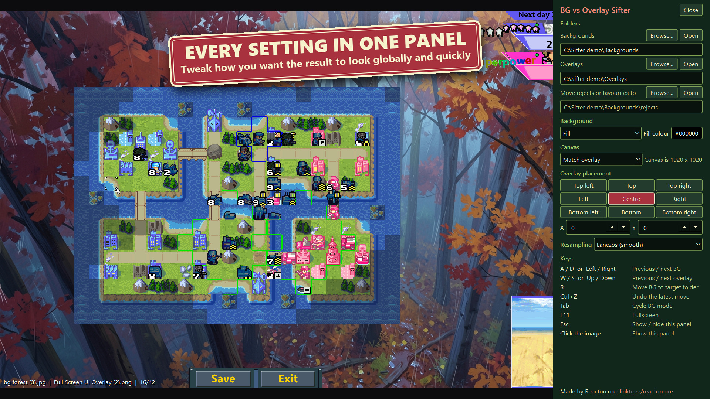

# BG vs Overlay Sifter

Which backgrounds actually work behind your UI? Put your overlay on top, flip through a folder of backgrounds with the keyboard, and move the ones that don't work out of the way with one key.



## What it's for

You have a folder of background images and a finished overlay: a game HUD, a menu, a title. Finding out which ones go together normally means toggling layers in an image editor, one at a time. Here you press a key and see the next one.

The first time, you choose your folders. After that the program opens straight back to where you were, ready to flip.

It also works in reverse: press R on the ones you like, and the target folder becomes your favourites.

## Requirements

Windows 10 or 11. Nothing to install: unzip the release and run `BG vs Overlay Sifter.exe`.

## How to use it

1. Choose your backgrounds folder in the side panel. It opens by itself the first time.
2. Optionally choose an overlays folder, and a folder for moved files. Moved files go to `rejects` inside the backgrounds folder unless you pick another.
3. Press Esc to close the panel and start flipping.

| Key | Action |
|---|---|
| A / D or Left / Right | Previous / next background |
| W / S or Up / Down | Previous / next overlay |
| R | Move this background to the target folder |
| Ctrl+Z | Undo the latest move (many times, this run only) |
| Tab / Shift+Tab | Cycle background mode: Fill, Fit, Stretch, Tile, Centre |
| F11 | Fullscreen |
| Esc | Show / hide the side panel |
| Left-click the image | Open the side panel |
| Alt+F4 | Quit |

See `guide.md` for the details.

## Good to know

- Prepare your overlays elsewhere: each one is a single finished image. This program does not build, edit or export images.
- Files are only ever moved, and never overwritten. A name clash becomes `foo (2).jpg`.
- Settings are remembered in `config.json`, next to the program. It is the only file the program saves.

## Running from source

This needs Python 3.13.

```
python -m venv .venv
.venv/Scripts/python.exe -m pip install -r requirements.txt
.venv/Scripts/python.exe main.py
```

Run the tests with `.venv/Scripts/python.exe -m pytest tests/ -q`.

## License

MIT, for this program's own code. See `LICENSE`.

It is built on [PySide6](https://doc.qt.io/qtforpython/) (Qt for Python, used under LGPL-3.0) and [Pillow](https://python-pillow.github.io/) (MIT-CMU), which keep their own licenses. A release carries their notices and license texts in its `licenses` folder, along with where to get the Qt and PySide6 source.

## Contact

mailto:reactorcoregames@gmail.com

---

Check out everything else I do: ✨🚀

https://linktr.ee/reactorcore

https://reactorcore.itch.io/

-Reactorcore

---

My other links:
Home/Links: https://linktr.ee/reactorcore
Releases: https://reactorcore.itch.io
Blog: https://www.patreon.com/ReactorcoreGames
Discord: https://discord.gg/UdRavGhj47
Catalog: https://reactorcoregames.github.io/

---

Made by Reactorcore - https://linktr.ee/reactorcore
